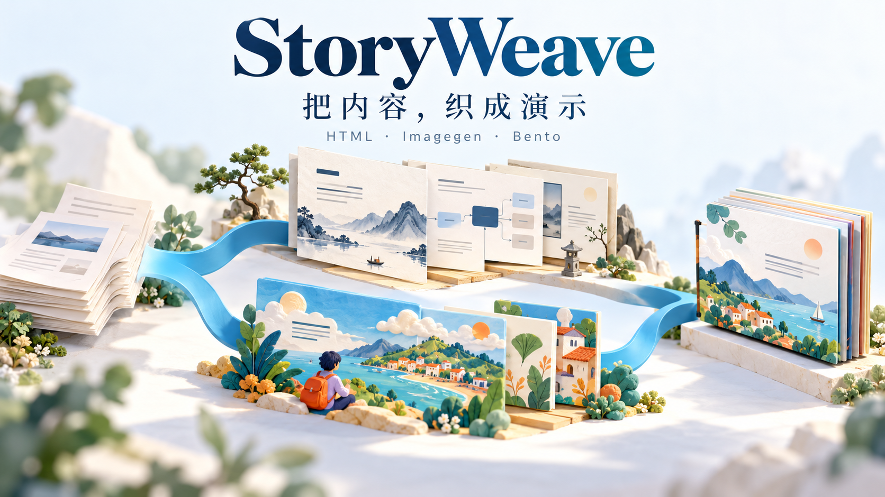
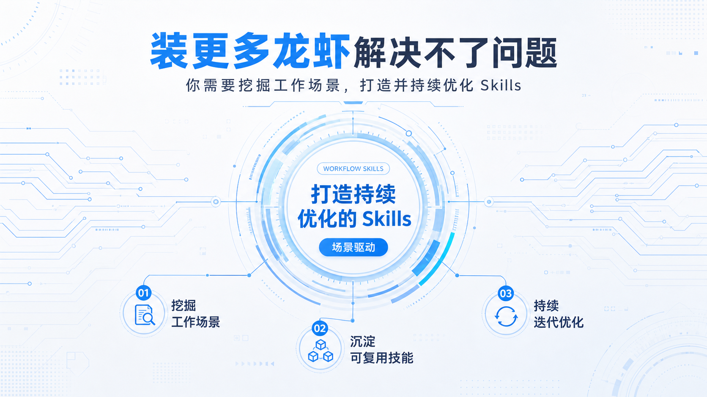
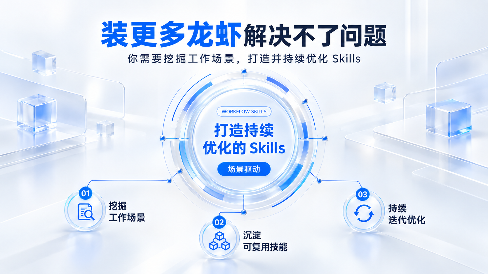
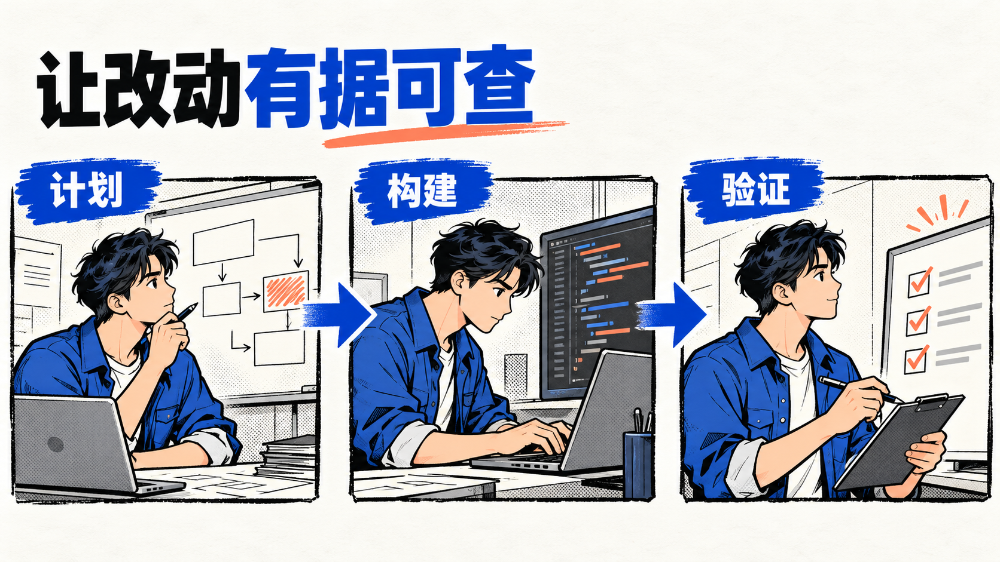
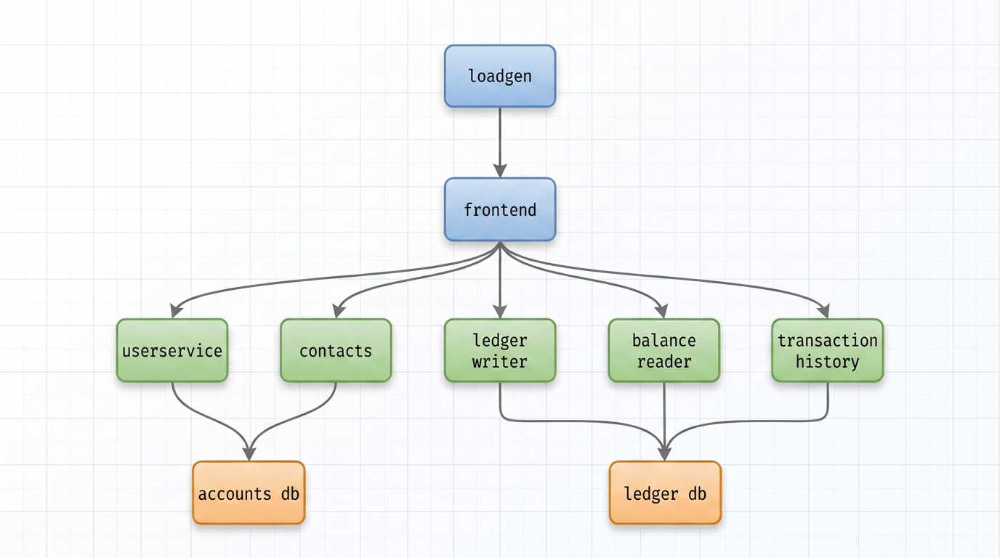
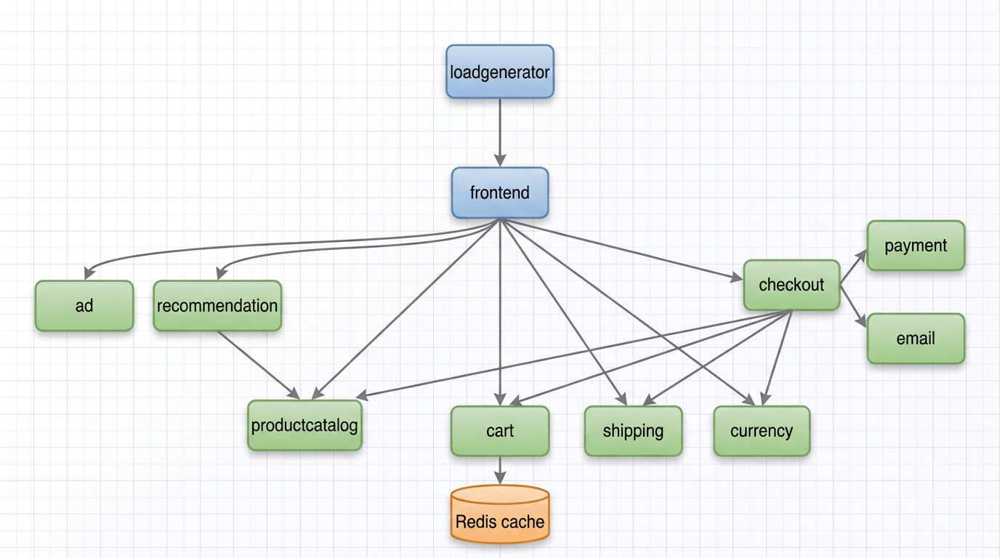

# StoryWeave



制作 16:9 演示文稿的 Agent Skill 集合。共享核心保存确认内容，HTML 和 Imagegen 分别生成原生页面或整页图片，通过 QA 后交给 Bento 包装与展示。

| Skill | 用途 | 交付物 |
| --- | --- | --- |
| [storyweave](skills/storyweave/SKILL.md) | 组织内容、选择生成器、推进交付 | 完整演示流程 |
| [storyweave-html](skills/storyweave-html/SKILL.md) | 技术分享、流程、对比和准确数据 | 可编辑的原生 HTML、SVG 与图表 |
| [storyweave-imagegen](skills/storyweave-imagegen/SKILL.md) | 插画、材质、场景及完整视觉叙事 | 整页 PNG、离线 HTML 画廊，可导出 PDF/PPTX |
| [storyweave-express](skills/storyweave-express/SKILL.md) | 将已有产物包装为 Bento | 调整页序、备注与播放 |

四个 Skill 可独立运行。权威实现位于 `src/`，分发时按依赖生成自包含 `runtime/`；Bento 使用随包的无损压缩壳。HTML 保留原生文字和图形，当前 Bento 与 PPTX 每页使用一张图片。

## 使用

需要 Node.js 20 以上。从仓库运行 CLI 时，先安装开发依赖与浏览器：

```bash
npm ci
npx playwright install chromium
node skills/storyweave-html/scripts/ppt.mjs draft ./my-deck --theme-ref systems/ink-blue-grid
```

编辑草稿并按已有授权确认内容后，继续构建和交付：

```bash
node skills/storyweave-html/scripts/ppt.mjs approve ./my-deck
node skills/storyweave-html/scripts/ppt.mjs build ./my-deck
node skills/storyweave-html/scripts/ppt.mjs qa ./my-deck --json
node skills/storyweave/scripts/orchestrate.mjs ./my-deck --no-bento-update --json
```

安装为 Agent Skill 时，运行 `node skills/<skill-name>/install.mjs`。`--dir` 指定安装根目录，`--force` 更新前保留备份；安装后按对应 Skill 的 `scripts/package.json` 安装所需第三方依赖。

确认内容保存在 `deck_spec.json`，两个生成器分别使用自己的视觉计划。换主题保留确认内容，修改内容或产物后重新 QA。旧 v2/v3 项目仍可读取，使用 `migrate-content` 显式迁移。

<!-- Geometry alone previously allowed visually worse revisions; generation and review now preserve semantic reading paths. -->
HTML 制作先读[视觉生成规则](docs/architecture/visual-generation.md)。构图由主张、比较轴、流程和关系决定，素材应解释具体内容；局部优化保留已有清楚的阅读路径。页面 QA 后还需查看逐页与整套效果，任何退步或不确定结果都不能作为视觉通过。

## Imagegen 主题与参考图

生成器现有 **19 套候选主题**，已将 18 种参考风格归并成 14 个主题方向，补成可直接选择的配方。相近的手绘白板、角色彩绘和玻璃风格合并，其余保留独立的绘画与材质语言。[完整主题与合并关系](skills/storyweave-imagegen/references/themes.md) · [19 套实际预览](skills/storyweave-imagegen/assets/examples/theme-previews/index.html)

默认优先浅色主题，深色主题保留为显式备选。以下流程样张使用同一份内容，用于比较媒介；复杂架构另看[应用架构案例](design-library/application-architecture-references/index.html)。

| 白底青蓝 | 银白玻璃 |
| --- | --- |
|  |  |

| 黏土流程 | 漫画工程 |
| --- | --- |
|  |  |

新增 **18 个应用架构与插画参考**，覆盖电商、银行、消息、视频、支付、搜索和 AI。16 个结构讲解案例归入 HTML/SVG，2 个浅色等距案例供 Imagegen 参考。以下两张原图随仓库保存，附上游许可；[全部来源与用途](design-library/application-architecture-references/README.md)。

| 银行业务边界 · Bank of Anthos | 电商服务调用 · Online Boutique |
| --- | --- |
|  |  |
| Google Cloud · Apache-2.0 | Google Cloud · Apache-2.0 |

[分享稿参考图库](skills/storyweave-imagegen/assets/reference-library/index.html)另收录 **18 种风格、41 张内容页**，可按观点、流程、对比、数据和架构筛选。每种参考风格均已对应到实际主题；纯 HTML 排版即可实现的案例归入 [HTML 参考目录](design-library/html-template-references/README.md)。联网版从来源加载原图，私有离线查看方法见[参考图说明](skills/storyweave-imagegen/references/presentation-cases.md)。

```bash
node skills/storyweave-imagegen/scripts/ppt.mjs draft ./image-deck --theme tactile/clay-workflow --scope authoring
```

Imagegen CLI 编译逐页任务，由 Agent 调用真实生图工具，再收集结果与逐页复核。主题仍为 candidate；编译通过不代表图片文字、构图或视觉质量已通过。

## 开发与评测

```bash
npm run package:skills
npm run check:packages
npm test
npm run doctor
```

[GitHub Actions CI](.github/workflows/ci.yml)在 push、PR 和手动评测时运行完整测试、八项功能验收，以及杂志、瑞士风各 8 页的 HTML 视觉回归。两套样张经过双视口浏览器 QA，再与实际看图确认的基线逐页比较；内容、画面或环境变化时检查失败并等待复核。CI 保留 HTML、截图、前后对照和评审模板。

每次评测都核对对应提交的 CI 结果，PR 合并前要求 `Verification` 成功。相同截图继承已有视觉判断；更新基线时，CI 会核对目标提交中的旧图，要求逐项比较前后效果。CI 不自动判定新画面的审美，也不调用付费生图。基线更新、artifact 下载与证据说明见 [CI 文档](docs/ci.md)。

[系统架构](docs/architecture/storyweave-target-architecture.md) · [重构与验收](docs/plans/storyweave-refactor-plan.md) · [包体积优化](docs/plans/storyweave-package-size-validation.md) · [验证 Skill](.agents/skills/verify-storyweave/SKILL.md)
