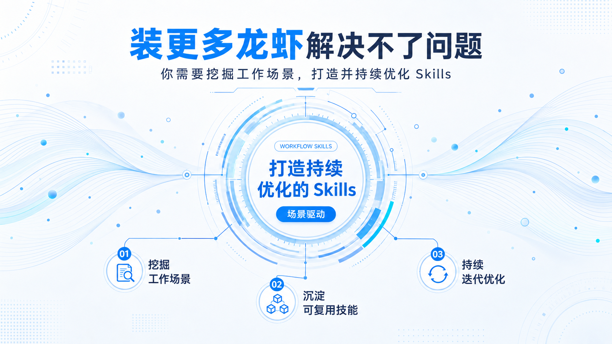

# StoryWeave

StoryWeave 是制作 16:9 演示文稿的 Agent Skill 集合。Agent 整理资料并推进内容确认，HTML 与 Imagegen 读取同一份确认内容，分别生成原生页面或整页图片。通过生产者 QA 后，Bento 展示适配器负责包装与展示。

## 文档入口

| 文档 | 内容 |
| --- | --- |
| [系统链路与模块职责](docs/architecture/storyweave-target-architecture.md) | 内容确认、两个生成器、设计参考、QA 与 Bento 的实际调用关系 |
| [重构实施与验收](docs/plans/storyweave-refactor-plan.md) | 已完成的迁移、兼容方法与验收标准 |
| [重构验证记录](docs/plans/storyweave-refactor-validation.md) | 八类用户路径、视觉前后对比、耗时和体积的实际结果 |
| [独立包体积优化](docs/plans/storyweave-package-size-validation.md) | 最小模块依赖、Bento 无损压缩和安装体积 |
| [项目验证 Skill](.agents/skills/verify-storyweave/SKILL.md) | 公开 CLI、真实浏览器、八类用户路径与可保留的证据 |
| [CI 与评测](docs/ci.md) | 每次 push、PR 和手动评测的完整测试、八项验收和保留证据 |

## 运行结构

| 模块 | 职责 | 结果 |
| --- | --- | --- |
| `src/core/` | 内容修订、公共合同、文件指纹与原子写入 | schema 4 确认内容、当前产物校验 |
| `src/html/` | 结构化内容的版式、原生 HTML 与 SVG、浏览器 QA | 独立页面、离线画廊与产物清单 |
| `src/imagegen/` | 构图计划、逐页任务、工具结果收集与图片复核 | PNG、离线画廊与图片式导出 |
| `src/design-library/` | 本地案例检索与所选参考页捕获 | 可追溯的设计参考 |
| `src/bento/`、`src/workflow/` | 校验生产者 QA，包装并检查 Bento | `.bento.html` 与独立适配报告 |

确认内容保存在 `deck_spec.json`。两个生成器分别使用 `plans/html.json` 与 `plans/imagegen.json`，换主题只更新视觉计划。旧 v2、v3 项目继续按原语义构建，通过 `migrate-content` 显式迁入 v4。

`storyweave-output.json` 保持 v1、v2 交接协议。`qa_report.json` 绑定实际输入和页面字节；修改后必须重新 QA。HTML 保留文字与图形编辑能力，当前 Bento 和 PPTX 每页使用一张图片。

共享实现只有一份 `src/` 源码，打包器按公开 CLI 的实际依赖生成自包含 `runtime/`。全局 Skill 自带 Bento 适配器，可独立包装已完成的生产者项目。Bento 官方原稿集中保存在 `vendor/bento/`，随包使用无损压缩文件，读取时校验恢复后的官方 SHA。内容策划和生图工具调用仍由 Agent 执行。

## Imagegen 主题

Imagegen 使用主题架构组织空间、样式定义材质与色彩、单页方案确定构图。当前提供六套候选样式，使用 `--scope authoring` 制作。图片默认保留简洁主标题和必要内容，主题不自动添加说明性小字；用户提供的文字按 `exact_text` 保留。

| 主题 | 完整引用 | 视觉方向 |
|---|---|---|
| 纸面编辑 | `editorial/paper-magazine` | 裁切摄影、宋体标题与干净纸边组成的编辑叙事 |
| 白底电路 | `systems/white-cyan-circuit` | 冷白底、精细圆环与低对比度电路纹样 |
| 参数化波纹 | `systems/white-cyan-wave` | 浅蓝平滑曲线、稀疏粒子与清晰的信息层级 |
| 银白玻璃 | `systems/silver-glass` | 通透玻璃模块、银白空间与钴蓝重点 |
| 朱红海报 | `campaign/bold-poster` | 朱红色场、大字与单一实物主体组成的传播画面 |
| 日常电影 | `cinematic/natural-film` | 自然曝光、可信动作与连续镜头组成的场景叙事 |

下列图片用于识别样式，各页面仍需核验实际文字、关系和数值。

| 纸面编辑 | 白底电路 |
|---|---|
|  |  |

| 参数化波纹 | 银白玻璃 |
|---|---|
|  |  |

| 朱红海报 | 日常电影 |
|---|---|
|  |  |

[主题目录](skills/storyweave-imagegen/references/themes.md) · [离线参考图画廊](skills/storyweave-imagegen/assets/examples/theme-previews/index.html)

在仓库根目录查看主题或创建候选主题草稿：

```bash
node skills/storyweave-imagegen/scripts/ppt.mjs themes --all --json
node skills/storyweave-imagegen/scripts/ppt.mjs draft ./my-deck --theme systems/white-cyan-wave --scope authoring --title "演示标题"
```

## 安装与使用

四个 Skill 可按需安装。安装器先校验包内指纹，`--dir` 指定安装根目录，`--force` 替换前保留可恢复备份。

```bash
node skills/storyweave/install.mjs
node skills/storyweave-html/install.mjs
node skills/storyweave-imagegen/install.mjs
node skills/storyweave-express/install.mjs
```

各 Skill 的 `scripts/package.json` 声明浏览器与导出依赖。安装器不复制 `node_modules`。进入安装后的 Skill 目录，安装所需依赖；HTML 浏览器路径还需要 Chromium。

```bash
npm install --prefix scripts
npm exec --prefix scripts -- playwright install chromium
```

从仓库根目录创建 HTML 项目，编辑草稿并取得用户确认后再运行审批。

```bash
node skills/storyweave-html/scripts/ppt.mjs draft <project> --theme-ref systems/ink-blue-grid
node skills/storyweave-html/scripts/ppt.mjs approve <project> --theme-ref systems/ink-blue-grid
node skills/storyweave-html/scripts/ppt.mjs build <project>
node skills/storyweave-html/scripts/ppt.mjs qa <project> --json
node skills/storyweave/scripts/orchestrate.mjs <project> --no-bento-update --json
```

Imagegen 编译任务后，Agent 调用真实 `image_gen`，将输出与调用记录通过 `record-result` 收集，再逐页复核。CLI 不调用生图服务，也不执行 OCR。具体步骤见 [Imagegen Skill](skills/storyweave-imagegen/SKILL.md)。

## 开发与验证

修改权威源码后重新打包，提交前检查生成副本与合同一致。

```bash
npm run package:skills
npm run check:packages
npm test
npm run doctor
node scripts/measure-packages.mjs
```

[功能地图](.agents/skills/verify-storyweave/features/README.md)覆盖 HTML 生成、播放、主题、Imagegen、Bento、案例引用和独立分发。合同 fixture 通过不能代替真实生图或人工视觉评审。

设计案例库使用本地文件与标签索引。目前收录的 `storyweave-knowledge-flow` 是仓库既有示例的六页生成截图，用于验证引用链路；优秀人工案例收录与设计规则提炼仍待完成。

## 目录

```text
StoryWeave/
├── src/             # 共享核心、生成器、案例检索与展示适配器
├── skills/          # 四个 Skill 的指令、资源与生成的 runtime
├── contracts/       # 公共主题合同
├── vendor/          # 保留原始字节的第三方 Bento 源码
├── design-library/  # 案例元信息、分析与标签索引
├── .agents/         # 项目验证 Skill
├── tests/           # 内容、版式、交接与分发回归
└── docs/            # 架构、实施、研究与历史资料
```

生产演示资源位于各 Skill 的 `assets/examples/`。验证工作目录与证据位于 Git 忽略的 `tmp/verification/`，文档不参与 Skill 运行。
