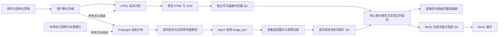

# StoryWeave 的系统链路与模块职责

StoryWeave 使用一份确认内容、两个生成器和一个 Bento 展示适配器。共享核心、独立视觉计划、案例检索与自包含打包已落到 `src/`。本文解释当前链路，迁移状态和验收步骤见[重构实施与验收](../plans/storyweave-refactor-plan.md)。

## 一份内容进入两条生成路径

Agent 从资料中整理主张、事实来源和信息关系。用户确认后，核心写入 schema 4 内容快照与 `revision`。HTML 和 Imagegen 各自生成绑定该修订的 schema 1 视觉计划，之后构建页面并检查实际文件。

图中的核心是 Node.js 进程内函数，没有常驻服务。Agent 负责内容理解、用户确认与工具调用，CLI 负责保存、规划、构建、检查和包装。全局编排命令消费已经完成的项目，不自动阅读资料或调用图片服务。

## 模块拥有自己的规则与状态

| 模块 | 拥有的职责 | 主要入口 |
| --- | --- | --- |
| 共享核心 | 内容身份、可见文字投影、公共主题与产物合同、文件指纹、原子写入 | [`src/core/content.mjs`](../../src/core/content.mjs)、[`artifact.mjs`](../../src/core/artifact.mjs) |
| HTML 生成器 | 字阶、版式、素材、DOM 与 SVG、浏览器 QA 和导出 | [`src/html/cli.mjs`](../../src/html/cli.mjs)、[`plan.mjs`](../../src/html/plan.mjs)、[`render.mjs`](../../src/html/render.mjs) |
| Imagegen 生成器 | 构图与提示词、逐页任务、结果收集、图片身份和复核 | [`src/imagegen/cli.mjs`](../../src/imagegen/cli.mjs)、[`plan.mjs`](../../src/imagegen/plan.mjs)、[`project.mjs`](../../src/imagegen/project.mjs) |
| 设计资料层 | 完整案例元信息、分析、标签检索与参考页捕获 | [`src/design-library/library.mjs`](../../src/design-library/library.mjs) |
| Bento 展示适配器 | HTML 栅格化、图片嵌入、shell 校验、文档包装与展示 QA | [`src/bento/presentation.mjs`](../../src/bento/presentation.mjs) |
| 全局工作流 | 组合已有产物的校验、包装与适配 QA | [`src/workflow/cli.mjs`](../../src/workflow/cli.mjs) |

核心只依赖 Node 标准库，不拥有 CSS、版式算法、Prompt 或浏览器。两个生成器共享内容与合同，各自持有视觉实现；它们不互相导入私有模块。

## 内容与视觉计划分别保存

| 文件 | 写入者与用途 |
| --- | --- |
| `outline_draft.json` | 作者或 Agent 编辑叙事、结构化内容、事实来源和独立的叙事参考 |
| `deck_spec.json` | 核心批准操作保存内容 schema 4、`revision` 与派生的 `exact_text` |
| `plans/html.json` | HTML 写入计划 schema 1，绑定 `contentRevision`，保存布局、主题、字体、素材与参考应用 |
| `plans/imagegen.json` | Imagegen 写入计划 schema 1，绑定 `contentRevision`，保存主题、构图与参考选择 |
| `generation_manifest.json` | 对应生成器保存页面或任务状态，Imagegen 另保存结果、实际参考输入与复核身份 |
| `storyweave-output.json` | 生成器写入页面顺序、稳定 ID、备注和相对路径，保持交接协议 v1、v2 |
| `qa_report.json` | 生产者写入检查结果和 `artifact_binding` |
| `qa/<output-id>.adapter-report.json` | Bento 按具体输出写入适配检查，不覆盖生产者报告 |

`approveContent()` 从结构化字段生成 `exact_text`。作者只维护一份可见内容，QA 使用同一投影检查遗漏和额外文字。`contentRevision()` 包含事实、关系、来源、备注和叙事参考，排除主题、布局与审批时间。

schema 4 的 `replan` 只改所属生成器的计划，保留 `deck_spec.json` 字节，重新构建不要求内容重新确认。修改文字或关系则回到草稿并重新确认。schema 2、3 项目仍按旧语义渲染；带 `--theme-ref` 的新 HTML 草稿与新 Imagegen 草稿默认使用 v4，`--schema 3` 可显式创建旧格式。

两套生产者的 `content_v4.schema.json` 均由核心 `contentSchema()` 生成。`migrate` 保留原有主题迁移含义，`migrate-content` 才显式迁入结构化内容。迁移保留文字并报告待补关系，不从旧字符串猜测流程、比较轴或指标单位。

## HTML 用信息关系选择页面结构

HTML 支持 `statement`、`comparison`、`process`、`metrics` 和 `graph` 五类结构。`role` 说明沟通任务，`content.type` 表达信息关系，`layout_id` 选择实际 DOM 或 SVG 骨架，主题控制配色与字型，`page_rhythm` 记录单页密度。

| 确认内容 | 计划中的版式 | 渲染关系 |
| --- | --- | --- |
| 比较列、行与值 | `comparison-matrix` | 共享比较轴与对齐的对照项 |
| 步骤与显式有向边 | `process-linear`、`process-loop`、`process-network` | 按确认关系绘制方向，只有存在环才可用循环构图 |
| 值、单位、标签与来源 | `metric-ledger` | 区分主指标、辅助指标和来源 |
| 节点与显式边 | `relationship-map` | SVG 表达关系，原生文字保留可审计性 |
| 标题与正文 | `statement`、`cover-split`、`closing-statement`、`quote` | 按沟通任务确定主张与留白 |

计划先检查页面容量，再确定字阶与素材槽位。素材使用比例、`fit`、裁切与焦点参与构图，图注来自确认内容。渲染器使用固定 `1280×720` 舞台，在竖屏视口整体等比缩放。

[`src/html/qa.mjs`](../../src/html/qa.mjs)检查独立页面及画廊中每一页的桌面与移动呈现，核对文字、比较行列、指标归属、节点详情、边、资源、布局与主题。幻灯片内外的额外可见文字、错误关系与过期参考哈希均可阻断交付。导航保持焦点时按空格的双触发已修复，验证仍保留原动作序列。

八页固定语料位于 [`tests/fixtures/visual/outline_v4.json`](../../tests/fixtures/visual/outline_v4.json)。同内容、同主题的前后截图与目视判断已记录在[重构验证记录](../plans/storyweave-refactor-validation.md)。新内容仍需检查阅读效果，不能仅依赖几何检查。

## 设计参考按需进入计划

`design-library/` 保存案例的 `source.json`、`analysis.md` 和可定位页面，`index.json` 由元信息生成。元信息记录来源、作者、页序、标签、受众与密度；分析分别说明叙事组织、视觉方法及适用范围。查询使用本地文件与标签索引。

[`scripts/index-design-library.mjs`](../../scripts/index-design-library.mjs)提供 `build`、`check`、`search` 和 `inspect`。`selectReferences()` 将所选页面复制到项目内并记录哈希，使项目不依赖案例库后续变化。原稿和大型资料不随每个 Skill 安装。

HTML 通过参考的 `application` 明确选择布局、色调、强调色或字体，并写入 `reference_applications`。只选中参考页不会自动成为已应用的设计。Imagegen 则将参考用途编入构图任务，把实际文件路径放入 `tool_input.referenced_image_paths`。

目前的 `storyweave-knowledge-flow` 使用仓库既有演示的六张截图，标明 `generated-verification-example`，作者未知。它证明检索、捕获与引用机制可执行，不代表优秀人工案例，也未被提升为设计规则。优秀案例收录、用新内容验证方法、提炼稳定规则仍需后续工作。

## Imagegen 的任务、工具调用与复核有各自证据

`prompts` 写出 `imagegen-jobs.jsonl` 和任务清单。Agent 读取每页任务，调用内置 `image_gen`，实际传入任务列出的参考图片。工具不可用或失败时，遵循用户级 `image-gen-rightcodes` 路由，不在生成器中新增图片 API。

`record-result --receipt <file>` 收集返回图片与工具调用记录，保存在项目内，并核对输出和参考哈希。计划中的参考选择与实际附件分别保存。文字提示、目录路径或手工写入的“已附图”不能代替实际调用参数。

生成后 `status` 区分 `needs-images`、`needs-review` 和 `ready-for-qa`。Agent 或用户检查真实图片的文字、裁切、额外元素和主题，再用 `review --pass` 绑定所见图片字节。替换 PNG 后，旧复核和 QA 失效。当前没有 OCR。

[`tmp/refactor-evidence/imagegen-live-01/`](../../tmp/refactor-evidence/imagegen-live-01/)保留了一次真实附图调用的输入、日志、返回图片与生产者 QA。返回图片为 `1672×941`，请求尺寸为 `2048×1152`，QA 记录尺寸 warning。这是本地捕获的实际请求与结果，不是独立供应商证明；该目录由 Git 忽略，需要随交付另行保留。

## 只有当前文件通过 QA 才能展示

`createArtifactBinding()` 记录清单、入口、页面及声明输入的字节哈希。生产者在验收前绑定文件，检查后再比对，拒绝检查期间发生的变化。`readVerifiedArtifact()` 要求生产者 QA 已通过，blocking 与 degraded 均为零，并重新读取实际文件。旧报告不能批准修改后的内容、计划、页面、素材或调用证据。

直接 Express 与全局工作流都调用这条公共校验。全局 Skill 内置 Bento 实现，无需相邻 Express 目录。HTML 按画布截图，PNG 直接复用；截图缓存绑定页面、素材、画布和栅格化版本，复用时核对图片字节；Bento 文档绑定完整生产者指纹。适配器保留页面 ID、顺序和备注，单独写入适配报告。

生产者 QA 通过后可以直接交付原始 HTML 或图片画廊。全局 Skill 默认继续包装 Bento。HTML 是原生编辑源，当前 Bento 与 PPTX 每页是一张图片，不保留 HTML 文字和形状对象。

## 共享源码在打包时复用

[`scripts/package-skills.mjs`](../../scripts/package-skills.mjs)从公开 CLI 入口解析本地模块依赖，只将可达的权威源码写入各 Skill 的 `runtime/`，同时生成薄 CLI 入口、公共 schema 和 `runtime/source-manifest.json`。构建使用 Node 语法解析而不执行应用代码；运行模块保持原路径和字节。`--check` 比较字节与清单，并检查过期模块、合同及原始 Bento 副本。

| 安装包 | 随包运行模块 |
| --- | --- |
| `storyweave-html` | core、HTML、案例检索 |
| `storyweave-imagegen` | core、Imagegen、案例检索 |
| `storyweave-express` | core、Bento |
| `storyweave` | core、Bento、workflow |

表中的 core 只包含该入口使用的模块。两个适配包没有内容审批和主题合同代码，生成器仍包含其所需公共模块。各包相互独立，不使用相邻 Skill 或共享运行时目录。

官方 Bento HTML 与来源记录保存在 [`vendor/bento/`](../../vendor/bento/)。两个展示包各带 `Bento_Slides.bento.html.br`，Node 标准库恢复后校验官方 SHA，再进行原有包装。来源 SHA 表示原稿，包清单 SHA 表示压缩文件。用户缓存和在线更新继续使用原 HTML 格式。体积与行为结果见[独立包验证](../plans/storyweave-package-size-validation.md)。

[`src/install.mjs`](../../src/install.mjs)是唯一安装器源码。安装前校验包内指纹，替换时保留旧安装备份。各包独立携带应用代码、合同与所需资源，浏览器和格式导出依赖由各包声明并安装。接受发布包重复字节，避免运行时跨 Skill 读取私有源码。

系统仍由本地文件、短命令和 Agent 工具调用组成。自动化证明合同、文件身份和交付行为，人工评审负责判断视觉效果与案例方法是否适用。
