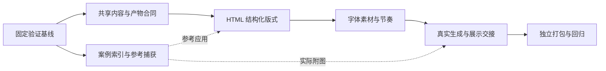

# 实施与验收 StoryWeave 重构

按切片维护共享规则、原生 HTML 版式、设计参考和展示交接。[系统链路与模块职责](../architecture/storyweave-target-architecture.md)解释当前实现；本文记录迁移顺序、完成条件与剩余工作，实测结果见[重构验证记录](storyweave-refactor-validation.md)。

## 按依赖顺序迁移

保留四个 Skill 的公开入口。共享实现集中在 `src/`，打包器为各 Skill 生成自包含运行包。调用者迁移后删除旧实现，v2、v3 渲染保留在兼容路径。



| 切片 | 当前文件 | 已实现行为 | 尚需验收或维护 |
| --- | --- | --- | --- |
| P0 基线 | `.agents/skills/verify-storyweave/`、`tests/fixtures/visual/outline_v4.json` | 七类公开用户路径、八页固定内容、截图与清理后证据校验 | 当前报告已保存，源码变化后重跑 |
| P1 共享合同 | `src/core/` | 内容 schema 4、计划绑定、公共产物校验、文件指纹与原子写入 | 持续检查旧版本兼容与公共边界 |
| D1 设计参考 | `src/design-library/`、`design-library/`、`scripts/index-design-library.mjs` | 标签检索、完整案例元信息、项目内参考捕获 | 优秀人工案例收录、新内容方法验证与规则提炼 |
| P2 HTML 构图 | `src/html/{plan,render,legacy}.mjs` | 比较、流程、指标、关系图与观点页面，空格双触发修复 | 同内容前后评审已保存，新内容继续核对 |
| P3 字体与节奏 | HTML plan、render、assets、qa | 字阶、长标题、素材槽位、页面容量与明暗节奏 | 固定语料缩略图已评审，照片与品牌资产另验 |
| P4 生成与交付 | `src/imagegen/{plan,project}.mjs`、`src/bento/`、`src/workflow/` | 实际附图任务、结果收集、图片复核绑定、独立适配报告 | 真实图片与 Bento 已复核，保留尺寸 warning |
| P5 独立分发 | `scripts/package-skills.mjs`、`src/install.mjs` | 权威源码打包、字节清单校验、恢复备份、全局包内置 Bento | 隔离安装与回归已记录，体积初拟预算未达 |

## P0 固定基线并保留证据

- [x] 建立 [verify-storyweave](../../.agents/skills/verify-storyweave/SKILL.md)，覆盖公开 CLI 与真实 Chromium。
- [x] 保存 `1280×720` 与 `390×844` 页面状态、截图、命令和 trace，清理后校验证据哈希。
- [x] 固定[八页视觉语料](../../tests/fixtures/visual/outline_v4.json)，包含封面、观点、比较、流程、指标、关系图、长标题和收尾。
- [x] 在 [`tmp/refactor-evidence/before/`](../../tmp/refactor-evidence/before/)保存相同内容、`systems/ink-blue-grid` 主题的旧版基线及通过的生产者 QA。
- [x] 为当前候选版本保留同条件截图、完整功能报告与[Agent 目视评审结论](storyweave-refactor-validation.md)。

`verification-final-02` 是早期六页样本的历史记录，其中空格键失败已在本次 HTML 实现中修复。当前验收继续执行“下一页、上一页、空格”的原动作，不通过移走焦点改变条件。

本地证据位于 Git 忽略目录。移交 checkout 时保留证据副本，或按功能地图重新生成。

## P1 统一内容与公共合同

- [x] 用 `src/core/content.mjs`保存结构化内容、稳定 ID、来源、叙事参考、修订与可见文字投影。
- [x] 两个生成器共用内容 schema 4，分别将视觉选择放入计划 schema 1。
- [x] 将原子文件写入、公共主题合同、输出校验和产物绑定集中到 core。
- [x] 直接 Express 与全局编排均通过 `readVerifiedArtifact()` 校验当前生产者报告。
- [x] 由 `contentSchema()` 与 `outputSchema()` 同源生成各包 schema。
- [x] 全量回归 106 项通过，独立安装测试 3 项通过；完整浏览器功能报告另行保存。

| 数据 | 当前约定 |
| --- | --- |
| 草稿与批准内容 | `schema_version: 4`，批准内容含 `revision` 与派生 `exact_text` |
| HTML 与 Imagegen 计划 | `schema_version: 1`，绑定 `contentRevision` |
| 产物清单 | 保持 manifest v1、v2 的 producer、kind 与版本组合 |
| 主题合同 | 保持 `contract_version: 1` |
| 生产者 QA | 使用 `artifact_binding` 绑定实际输入、入口与页面字节 |

带 `--theme-ref` 的 HTML 草稿与 Imagegen 新草稿默认生成 v4；需要旧 canonical 样本时显式使用 `--schema 3`。现有 v2、v3 继续读取并按原语义渲染。`migrate` 保留主题迁移语义，`migrate-content` 保留原稿并迁入 v4 草稿。比较、流程和数据的旧字符串保留为文字，同时报告待补结构；作者补齐关系后再确认。

## D1 建立可追溯的案例参考

- [x] 使用 `cases/<case-id>/source.json`、`analysis.md` 和生成的 `index.json` 保存来源、页序、分析与检索元信息。
- [x] 提供 `build`、`check`、`search`、`inspect`，按标签、角色、受众与密度筛选。
- [x] 捕获所选页面到项目 `references/`，记录用途和哈希。
- [x] HTML 保存具体参考应用，Imagegen 输出待传给工具的参考路径。
- [x] 案例原稿与全部截图不进入每个 Skill 安装包。
- [ ] 收录优秀人工演讲或演示案例，核对授权、作者和原始页序。
- [ ] 将叙事方法用于新内容的开场、论证、转场和收束，并保存独立的叙事参考。
- [ ] 在新观点页、流程页和数据页验证方法，保存生成与复核依据。
- [ ] 将稳定方法提炼到现有叙事、architecture、style 或 visual scheme 规则并回归。

目前仅有 `storyweave-knowledge-flow`，来源是仓库既有六页生成截图，作者未知，类型为 `generated-verification-example`。它验证引用机制，不计作优秀人工案例或已验证设计规则。标签检索使用本地文件，不增加服务或向量数据库。

## P2 与 P3 验收原生 HTML

- [x] 内容显式表达比较轴、步骤与方向、指标值与来源、节点与关系。
- [x] `layout_id` 选择不同 DOM 或 SVG 骨架，不从字符串位置补造关系。
- [x] 从结构化内容生成准确文字，检查页面内外额外文字、比较行列、指标归属、节点详情与关系边。
- [x] 隔离旧渲染路径，现代构建读取独立的 `plans/html.json`。
- [x] 换主题只更新 v4 视觉计划，确认内容保持原字节。
- [x] 定义字阶、长标题容量、素材 fit 与裁切，拒绝超出所选版式容量的内容。
- [x] 检查独立页与画廊逐页的双视口呈现，修复导航焦点下空格双触发。
- [x] 完成同内容前后截图评审，逐页说明构图改善与残留问题。
- [x] 查看整套缩略图，核对密集页、留白、明暗与重点；修复长标题末行单字。

视觉比较使用八页固定语料与相同主题，避免把换色当作结构改进。再用新内容检查布局适用性；数字、品牌、人物和论断都来自该项目确认材料。

## P4 核对真实附图与展示交接

- [x] `prompts` 从批准内容与私有计划生成任务，`tool_input.referenced_image_paths` 列出实际待传图片。
- [x] `record-result` 收集实际调用记录、参考哈希和返回图片，保持选择与实际输入分开。
- [x] `status` 区分缺图、待复核与可 QA；逐页 Review 绑定实际图片字节。
- [x] 完成一次真实 `image_gen` 附图调用，证据位于 [`imagegen-live-01/`](../../tmp/refactor-evidence/imagegen-live-01/)。
- [x] Bento 按页面、素材与渲染条件复用截图，输出绑定生产者指纹，保留 ID、顺序、备注与源文件。
- [x] 适配器独立写 `qa/<output-id>.adapter-report.json`，保留生产者 `qa_report.json`。
- [x] 对最终图片与全部适配输出保留当前版本的复核结论和完整功能报告，两个生成器的四种格式导出均已检查。

真实样本返回 `1672×941`，请求为 `2048×1152`，生产者 QA 可导出并保留尺寸 warning。实际图片已经视觉复核，未执行 OCR。请求、日志与图片是捕获到的调用证据，不是独立供应商证明。

## P5 检查独立分发

- [x] 从唯一源码生成各 Skill 的 `runtime/` 与字节清单，`--check` 拒绝副本漂移。
- [x] 用同一安装器校验包内指纹，`--force` 更新保留可恢复备份。
- [x] 全局包内置 Bento，不通过兄弟 Express 私有目录包装。
- [x] 生成器不配置案例库也可使用内置规则，完整案例资料不随安装复制。
- [x] 四包在不同安装根目录及 checkout 外工作目录执行 doctor，已安装 HTML 与全局 Bento 路径通过；显式记录既有 Playwright 来源。
- [x] 删除旧 scripts/lib 与 Express 重复脚本，同步四个 Skill 与七类功能地图。
- [x] 全量测试通过，包内副本与源码一致。
- [x] 保存当前七类用户路径报告并完成清理后证据校验；另验 Imagegen 缺图状态。

隔离分发验证显式通过 `NODE_PATH` 使用预装的第三方 Playwright，并记录其路径。该验证证明应用代码和资源来自独立安装包，不代表重新安装过第三方依赖。

## 分别判断行为、视觉与性能

| 验收面 | 自动检查 | 人工判断 |
| --- | --- | --- |
| 内容 | 文字、来源、ID、顺序、备注守恒，关系与文字投影一致 | 没有移入案例事实，标题与图解没有无意义重复 |
| 舞台 | `1280×720` 固定舞台，`390×844` 等比缩放，无资源损坏或意外越界 | 主张、视觉重点和阅读顺序清楚 |
| 字体与容量 | 按计划检查字号、标题行数和页面容量 | 层级、行距与留白可读，没有靠缩小字隐藏问题 |
| 引用 | 案例页、用途、哈希与实际工具输入可对应 | 方法适用于新内容，引用决定具体 |
| 质量状态 | 浏览器检查执行，blocking 与 degraded 为零，QA 绑定当前文件 | warning 逐项说明，图片与全套视觉结论有依据 |
| 分发 | 标准库核心、包内指纹一致、独立运行、无完整案例库 | 新依赖与资源体积有用途 |

正文至少 24 px、图注至少 16 px、普通标题最多两行、长标题最多三行是视觉评审的起始阈值。部分规则已有实现，仍需结合固定语料逐页核对，不能以 `export_ready` 代替全部视觉判断。

目视评审为主张聚焦、信息关系、字体层级、素材表达和全套节奏各记 0 至 2 分，并附页面与原因。首轮目标为至少 8 分且没有 0 分项。基线低于 8 分时至少提高 2 分；已达标时修复指定缺口并保持其他项不退步。本次 Agent 主观评分与截图依据见验证记录，评分不等于客观质量指标或用户审美确认。

性能和包体积已按固定机器、Node、浏览器、依赖、主题与语料实测，各预热一次，再交替测量五次。QA 耗时符合初拟的 1.2 倍预算；构建位于阈值边缘且区间重叠，尚不能判断稳定差异。首轮运行包合计约为旧版两倍，主要增量来自全局包独立携带 Bento，口径、采样与限制见[首轮验证记录](storyweave-refactor-validation.md)。后续[独立包优化](storyweave-package-size-validation.md)按入口删除未使用模块，并无损压缩 Bento，必需运行文件由约 1.89 MiB 降至 1.51 MiB。四包仍独立运行，体积仍高于重构前初拟的 1.1 倍预算。

## 运行验证并保留证据

修改 `src/` 后先重新打包，再执行回归与[功能地图](../../.agents/skills/verify-storyweave/features/README.md)。

```bash
npm run package:skills
npm run check:packages
npm test
VERIFY_RUN_ID="verify-$(date -u +%Y%m%dT%H%M%SZ)-$$"
node .agents/skills/verify-storyweave/scripts/verify.mjs doctor
node .agents/skills/verify-storyweave/scripts/verify.mjs launch --run-id "$VERIFY_RUN_ID"
node .agents/skills/verify-storyweave/scripts/verify.mjs drive html-authoring --run-id "$VERIFY_RUN_ID"
node .agents/skills/verify-storyweave/scripts/verify.mjs drive html-playback --run-id "$VERIFY_RUN_ID"
node .agents/skills/verify-storyweave/scripts/verify.mjs cleanup --run-id "$VERIFY_RUN_ID"
node .agents/skills/verify-storyweave/scripts/verify.mjs report --run-id "$VERIFY_RUN_ID"
```

需要验证其余功能时，将对应 drive 命令放在 cleanup 之前。失败后也清理并读报告；修复后重新运行 doctor，使用新的 run ID。Imagegen 默认任务路径返回 `needs-images`，`--source-project` 只检查已有图片，不声称本次生图。清理删除 `work/`，保留 `evidence/` 的命令、产物、动作、截图、trace 与哈希。

## 在切片边界回退

每个切片保存前后证据。验收失败时保留失败产物，回退该切片或使用上一份已验证包，从确认内容重新构建。保留用户改动、确认内容与案例原始资料；规则回退不通过删除案例掩盖方法不适用。

完成重构验收时，确认当前源码有完整功能报告，自动检查与人工视觉结论分别可查，旧版兼容、真实附图、Bento 和独立安装均有对应证据。案例收录与规则提炼按 D1 单独推进，不因机制可运行而自动结项。
