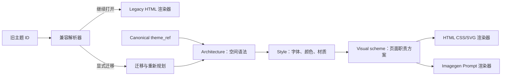

# StoryWeave HTML 与 Imagegen 主题收敛改善方案

本文保留主题收敛前的提案与判断。当前模块、内容版本和运行链路见[系统架构](architecture/storyweave-target-architecture.md)。

| 项目 | 内容 |
| --- | --- |
| 文档类型 | 技术改善提案 |
| 适用范围 | `storyweave-html` 主题目录、解析器和 HTML 渲染器 |
| 对齐对象 | `storyweave-imagegen` v3 主题目录 |
| 当前状态 | 评审修改稿 |
| 主要结论 | 主题按「架构 → 样式 → 页面方案」分层；旧主题保留原样渲染入口，只有显式迁移后才进入 canonical 合同 |

## 1. 摘要

当前 HTML 主题目录有 8 个平级主题：`business-minimal`、`editorial`、`swiss-grid`、`launch-tech`、`data-consulting`、`academic`、`brand-bold` 和 `premium-dark`。这些名称同时表达了版式语法、使用场景、颜色和材质，导致主题之间的边界不稳定。

Imagegen 已经使用三层模型：

HTML 可以沿用这套分层方式，但不能只把 8 个 ID 改名为 4 个 ID。更稳妥的目标是：

- 对外收敛为 4 个架构家族：`editorial`、`systems`、`campaign`、`cinematic`。
- 用 style 表达字体、颜色、材质和 HTML 专属视觉表面。
- 用 visual scheme 表达封面、对照、流程、数据和收束等页面职责。
- 保留旧主题 ID 和旧渲染能力，把“继续打开”与“迁移到新主题”分成两条路径。
- 迁移时区分确定映射与需要人工确认的映射，不用别名解析代替迁移。
- 让 HTML 和 Imagegen 共享主题引用、页面角色和布局约束，不共享彼此专属的 CSS 或 Prompt 实现。
- 用版本、配方 hash、渲染器版本和 deck hash 判断现有输出是否需要重建。

## 2. 当前实现

### 2.1 HTML 主题是平面 token 表

`skills/storyweave-html/assets/themes/themes.json` 中的 8 个主题都声明了相同的 10 个页面角色，并且每个主题都有 3 个 `variants`。当前渲染路径实际使用的是主题 ID、别名和 `tokens` 中的背景色、表面色、文字色、强调色、字体和圆角等值，其他主题描述没有改变页面结构。

这意味着当前主题的主要差异是 CSS 表面，而不是页面的空间组织或叙事节奏。`html.mjs` 对所有主题使用同一套页面结构：左侧文字区、右侧装饰区、统一的标题和内容规则。主题目录中的 `variants` 目前没有独立解析路径，也没有参与 HTML 输出。

还有一个需要修正的行为：`resolveTheme` 遇到未知 ID 时会回退到 `business-minimal`。主题拼写错误或旧 ID 失效时，构建仍可能成功，但结果会悄悄变成另一个主题，问题不容易被发现。

### 2.2 Imagegen 已经具备可复用的分层合同

Imagegen v3 的主题目录包含：

- `architecture`：空间语法、阅读顺序、密度策略和整套 deck 的节奏。
- `style`：艺术方向、调色板、字体、材质、视觉锚点、对比度和禁止项。
- `visual_scheme`：页面角色可用的构图、图像方向、标题处理、文字安全区、视觉区和密度约束。
- 解析和验证：主题状态、作用域、角色支持、布局冲突、跨主题引用和主题配方哈希。

当前已有 4 个候选架构/样式组合：

| 架构 | 样式 | 主要空间语法 |
| --- | --- | --- |
| `editorial` | `editorial/paper-magazine` | 出版物式非对称版面，文字、图片和图解共同组织阅读顺序 |
| `systems` | `systems/white-cyan-circuit` | 节点、路径和显式分组解释系统关系 |
| `campaign` | `campaign/bold-poster` | 单一传播主体、强主张和平面构图形成视觉焦点 |
| `cinematic` | `cinematic/natural-film` | 镜头方向、光线和空间纵深组织连续场景 |

Imagegen 的迁移代码只为少数旧主题提供确定映射，例如 `editorial` 和 `wuming-cyan-circuit`。其他旧主题如果没有明确映射，会要求用户重新选择主题，而不是静默转换。这一规则应保留到 HTML。

## 3. 需要解决的问题

### 3.1 主题名称混合了不同层级

当前主题中，`editorial`、`swiss-grid`、`launch-tech` 和 `premium-dark` 更接近视觉语法；`business-minimal`、`data-consulting` 和 `academic` 同时带有使用场景和内容类型。它们放在同一层级，难以判断一个新主题应该是新的架构、样式还是页面方案。

### 3.2 主题声明的能力没有进入渲染器

主题文档可以描述杂志节奏、证据对齐或技术线条，但 HTML 渲染器不会据此改变页面结构。继续增加主题只会增加 token 表，而不会增加可复用的页面能力。

### 3.3 `variants` 形成了未兑现的选择

8 个主题声明了 24 个变体名称，但当前 CLI 和渲染器没有 `variant` 参数，也没有变体 token 解析。继续保留这些名称会让使用者误以为它们已经可用。

### 3.4 两个 Skill 的主题模型会继续分叉

HTML 使用单层 `theme`，Imagegen 使用 `theme_ref` 和 `visual_scheme_ref`。如果两个 Skill 继续维护不同的主题 ID、角色和布局约束，同一套 StoryWeave 主题会在两种输出模式中产生不同的选择结果和迁移规则。

## 4. 目标模型

### 4.1 Architecture：收敛为 4 个家族

| Architecture | 负责回答的问题 | 适合的内容 |
| --- | --- | --- |
| `editorial` | 读者如何在主张、留白、图片和图解之间停留 | 行业观点、研究报告、管理叙事、人物和出版物式内容 |
| `systems` | 读者如何沿节点、路径、分组和证据理解关系 | 技术架构、运营流程、数据关系、系统治理 |
| `campaign` | 读者如何快速记住一个主张、主体或行动 | 品牌活动、产品发布、创意提案、海报式传播 |
| `cinematic` | 读者如何通过空间、光线和动作理解一段场景 | 场景叙事、人物关系、空间体验、高端主旨演讲 |

Architecture 只定义空间和阅读逻辑，不直接决定背景色、字体或具体页面标题大小。

### 4.2 Style：保留可区分的视觉表面

首批可以采用 Imagegen 已有的 4 个样式引用作为 canonical style，同时补充 HTML 需要的可编辑表面。这里共享的是引用和语义，不是 Imagegen 的主题文件或 Prompt 实现：

| Style 引用 | 来源或状态 | 目的 |
| --- | --- | --- |
| `editorial/paper-magazine` | 已有 | 纸面、衬线标题、编辑式留白 |
| `systems/white-cyan-circuit` | 已有 | 浅色技术场、青蓝信号、系统关系 |
| `campaign/bold-poster` | 已有 | 强色块、传播主体和海报式主张 |
| `cinematic/natural-film` | 已有 | 自然光、空间纵深和人物动作 |
| `editorial/business-clean` | 建议新增 | 结论先行、宽留白、细规则、商务字体 |
| `editorial/academic-journal` | 建议新增 | 出版物层级、图注、证据留白 |
| `systems/boardroom` | 建议新增 | 证据对齐、比较结构和经营汇报密度 |
| `systems/terminal` | 建议新增 | 深色技术舞台、低密度光线和技术线条 |
| `campaign/swiss-grid` | 建议新增 | 严格模块网格、海报式字号和高对比结构 |
| `cinematic/premium-dark` | 建议新增 | 深色舞台、低调高光和主旨演讲气质 |

这些 style 是视觉表面和编辑规则的候选名称，不代表已经存在于当前 Imagegen catalog。新增前需要至少完成一套 HTML golden deck 和一套浏览器截图复核。

### 4.3 Visual scheme：按页面职责提供构图方案

HTML 不需要直接复制 Imagegen 的图像 Prompt，但需要共享页面职责和布局约束。每个 active style 必须通过 `role_defaults` 覆盖全部 10 个共享页面角色。尚未实现专属结构的角色可以落到明确的通用 scheme，不能留空或在运行时临时猜测。

| 页面职责 | HTML 需要约束的内容 | Imagegen 中的对应例子 |
| --- | --- | --- |
| `cover` | 主张区、视觉锚点、首屏留白 | `magazine-cover`、`keynote-cover`、`poster-claim` |
| `section` | 章节标识、过渡节奏和后续内容预告 | `editorial-statement`、`campaign-signal` |
| `statement` | 单条结论的字号、位置和安静区 | `editorial-statement`、`signal-quote` |
| `image-hero` | 图片槽位、裁切边界、标题安全区和图注 | `profile-feature`、`film-scene` |
| `two-column` | 两个并列信息区的列宽、基线和间距 | `comparison-spread` |
| `comparison` | 对照维度、列宽、基线和中间间距 | `comparison-spread`、`comparison-matrix` |
| `process` | 顺序、方向、节点和阶段间距 | `editorial-diagram`、`system-map`、`campaign-flow` |
| `data` | 指标、证据和说明的层级 | `data-overview`、`campaign-data`、`film-evidence` |
| `quote` | 引文区域、归属信息和背景对比度 | `profile-feature`、`signal-quote` |
| `closing` | 收束主张、视觉减弱和最后一个动作 | `quiet-ending`、`campaign-signal` |

Visual scheme 应包含 `text_safe_zones`、`visual_zones`、`density` 和必要的 `hierarchy`。HTML 渲染器据此选择 CSS/SVG 结构；Imagegen 渲染器据此编译 Prompt。两者共享约束，不共享实现细节。

### 4.4 旧主题兼容状态

兼容解析和主题迁移是两个操作。兼容解析只决定当前项目能否按原视觉继续构建，不修改项目文件；迁移命令才会写入 canonical `theme_ref` 并重新规划页面。

| 状态 | 解析结果 | 是否允许构建 | 是否写入 canonical `theme_ref` |
| --- | --- | --- | --- |
| `canonical` | 已解析的 architecture/style；逐页 scheme 由 `resolveVisualPlan` 解析 | 是 | 是 |
| `legacy-compatible` | 旧主题 ID、旧 token 和旧通用渲染器 | 是 | 否 |
| `needs-selection` | 旧主题可继续按 legacy 路径构建，但迁移目标有歧义 | 是 | 否，运行迁移命令时要求选择 |
| `unknown` | 不存在的主题或拼写错误 | 否 | 否，返回 blocking 错误 |

`resolveTheme` 应返回带 `kind` 和 `migration_status` 的判别对象。`legacy-compatible` 和 `needs-selection` 必须保留旧 token 与旧渲染结构，不能为了满足新字段格式而选择一个近似 style。只有确定映射或用户显式选择后，`migrate` 才生成 v3 项目。

### 4.5 Catalog 作用域和发布状态

HTML 与 Imagegen 统一使用 `active`、`candidate` 和 `planned` 三种主题状态，以及 `active`、`authoring` 两种 catalog scope：

- canonical 路径中的 `draft`、`approve` 和 `build` 默认使用 `active`，不能解析 candidate 或 planned style。切换默认路径前，现有 legacy draft 流程继续可用。
- 主题开发和 golden deck 构建显式使用 `authoring`，可以解析 candidate，仍不能解析 planned。
- 迁移默认只能指向 active style；试迁移到 candidate 必须显式指定 `--catalog-scope authoring`，产物不能标记为正式可发布。
- candidate style 完成角色覆盖、golden deck、浏览器 QA 和跨 Skill 合同测试后，才能晋升为 active。
- 已批准项目记录 catalog 合同版本和主题配方 hash。style 后续降级或撤销时，已有项目可以按固定配方重建，但不能创建新的引用。

## 5. 旧主题迁移建议

下表是分类建议，不是可以直接执行的批量改名。只有视觉结果已经通过 golden deck 对比，才可以加入确定迁移表。确定映射仍需通过 `migrate` 命令写入项目，不在打开项目时自动改写。

| 旧主题 ID | 目标架构 | 候选 style | 迁移映射建议 | 原因 |
| --- | --- | --- | --- | --- |
| `editorial` | `editorial` | `editorial/paper-magazine` | 可作为第一批确定映射 | 与现有 Imagegen 样式的空间语法最接近 |
| `business-minimal` | `editorial` | `editorial/business-clean` | `needs-selection` | 它强调商务结论和宽留白，需要独立 HTML token |
| `academic` | `editorial` | `editorial/academic-journal` | `needs-selection` | 需要图注、证据层级和正文/标题字体组合 |
| `data-consulting` | `systems` | `systems/boardroom` | `needs-selection` | 经营分析的密度和系统关系图不完全相同 |
| `launch-tech` | `systems` | `systems/terminal` | `needs-selection` | 当前 Imagegen 的白底青蓝样式不能代表原有深色舞台 |
| `swiss-grid` | `campaign` | `campaign/swiss-grid` | `needs-selection` | 严格网格是结构约束，不只是颜色变体 |
| `brand-bold` | `campaign` | `campaign/bold-poster` | 视觉复核后可作为确定映射 | 传播主体和强主张方向一致，但 HTML 版式仍需复核 |
| `premium-dark` | `cinematic` | `cinematic/premium-dark` | `needs-selection` | 需要确认它是舞台风格还是影像叙事风格 |

当前 HTML 的兼容解析器应支持旧 ID，但不应为待确认映射伪造 canonical `theme_ref`。解析结果应包含旧主题 ID、兼容状态、可选的目标建议和原有 token。确定映射只有在运行 `migrate` 后才写入项目；待确认映射必须由用户选择。未知 ID 不应再默认回退到 `business-minimal`，而应报告明确错误。

迁移前后的内容守恒检查至少覆盖 `id`、`role`、`purpose`、`claim`、`exact_text`、`evidence`、`sources` 和 `speaker_notes`。`visual_brief`、`visual_scheme_ref`、`visual_anchor_id`、`layout_plan` 和连续性字段属于视觉计划，可以在迁移时重新生成，但必须在迁移报告中列出。

## 6. 实施方案

### 阶段零：冻结共享合同和所有权

1. 在仓库的 `contracts/storyweave-theme/v1/` 建立唯一的 `storyweave-theme-contract` 权威源，包含角色、区域、密度、状态、scope、引用格式和错误码的 JSON Schema。
2. 为合同设置独立的 `contract_version`。两个 Skill 发布时各自打包一份只读副本，运行时不跨目录加载，从而保持独立安装。
3. 增加合同 fixture 和 CI 一致性测试。两个 Skill 必须通过同一批合法、非法和边界输入；打包副本与权威源的 hash 不一致时构建失败。
4. 约定兼容策略：补充可选字段可以保持同一主版本；修改枚举语义、引用格式或必填字段必须提升合同主版本并提供迁移器。

### 阶段一：升级 HTML 输入模型

1. 新增 HTML v3 `outline_draft` 和 `deck_spec` schema，纳入 `catalog_scope`、`language`、`canvas`、`theme_ref`，以及逐页的 `visual_scheme_ref`、`visual_anchor_id`、`continuity_group` 和 `layout_plan`。
2. `draft --theme-ref <architecture/style>` 生成 v3 outline；v2 文件仍可读取，但不能被新渲染器直接当成 v3 使用。至少一个 style 晋升为 active 前，无参数 `draft` 继续生成 legacy outline。
3. 实现 `migrateOutline` 和 `replanOutline`。前者负责 v2 到 v3 的内容守恒迁移，后者只重建视觉字段并把项目恢复为 draft 状态。
4. `approve --theme-ref <architecture/style>` 通过 catalog 逐页解析 `auto` scheme，并把完整 visual plan 固化到 `deck_spec.json`。
5. `build` 只接受 approved deck。输入仍含 `auto`、主题与 scheme 不匹配或合同版本不兼容时返回 blocking 错误。

### 阶段二：建立 HTML 主题目录和兼容解析器

1. 为 HTML 增加与 Imagegen v3 对齐的 `catalog.json` 结构，至少包含 `architecture`、`style`、`status`、`roles`、`role_defaults` 和 `schemes`。
2. canonical 主题使用 `architecture/style` 引用，例如 `editorial/paper-magazine`。
3. 为每个旧主题保留旧 token，并记录 `legacy_aliases`、`migration_status`、确定目标或候选目标。
4. 将 `resolveTheme` 改为返回 `canonical`、`legacy-compatible`、`needs-selection` 或 `unknown`，未知 ID 不再回退到默认主题。
5. 增加 `resolveVisualPlan`，根据页面角色返回 style、scheme、布局约束、配方 hash 和诊断信息。
6. 对未知 style、跨主题 scheme、角色缺少默认 scheme 和布局冲突返回稳定的 blocking 错误码。
7. 把 `variants` 改为可解析的 style 或 token variant；没有实现计划的条目从对外目录中移除。

### 阶段三：改造 HTML 渲染器和输出指纹

1. 保留现有通用渲染器作为 legacy 路径，不改变旧项目的 token 和结构。
2. canonical 路径将 `role` 和 `visual_scheme_ref` 作为结构选择输入，先为 `cover`、`statement`、`comparison`、`process`、`data` 和 `closing` 实现专属结构。
3. `section`、`image-hero`、`two-column` 和 `quote` 在专属结构完成前使用 catalog 明确指定的通用 scheme，保证 10 个角色都有唯一默认解析结果。
4. 将文字安全区、视觉区、密度和层级变成可验证的 CSS/SVG 布局约束。
5. 不把整页截图作为 HTML 主题资产；可编辑文字、形状、表格、图表和 SVG 仍由 HTML 表达。
6. `storyweave-output.json` 和 generation manifest 记录 `contract_version`、`theme_ref`、逐页 `visual_scheme_ref`、`theme_recipe_sha256`、逐页 `visual_scheme_sha256`、`renderer_version` 和 `deck_spec_sha256`。任何一项变化都使已有输出失效。
7. approved deck 保存规范化后的主题配方快照及其 hash。style 降级后，已有项目仍能按固定配方重建；新项目不能再选择该 style。

### 阶段四：Golden deck 和 active 晋升

1. 对每个 candidate style 生成固定内容、固定 16:9 画布的 golden deck，覆盖全部 10 个角色。
2. 在桌面演示视口、移动浏览视口和逐页独立入口检查空白、溢出、重叠、字体加载、资源路径和交互。
3. 为关键 scheme 保存基线截图。视觉差异必须经人工复核，不能只依赖像素相等。
4. candidate 只有在角色覆盖、合同测试、结构测试、浏览器 QA 和视觉复核全部通过后才能晋升为 active。
5. 首批至少晋升一个 active style 后，canonical 路径才能成为 HTML 默认路径；在此之前继续使用 legacy 默认主题。

### 阶段五：迁移和淘汰

1. 先为 `editorial` 和 `brand-bold` 做视觉复核，形成第一批确定迁移。
2. 对 `business-minimal`、`academic`、`data-consulting`、`launch-tech`、`swiss-grid` 和 `premium-dark` 保留 legacy 构建能力，迁移时要求显式选择。
3. CLI 增加 `migrate <dir> --theme-ref <architecture/style>` 和 `replan <dir> --theme-ref <architecture/style>`；迁移输出内容守恒报告和视觉字段变更报告。
4. 迁移不得修改标题、页面 ID、角色、主张、`exact_text`、证据、来源或讲稿备注。
5. 连续一个版本周期没有新的旧主题引用后，只能评估是否隐藏旧主题选择入口。删除 legacy 构建能力需要单独的弃用周期、迁移覆盖率证据和主版本变更。

## 7. 验收标准

### 主题目录

- 能列出 4 个架构、各自的 style 和每个 style 支持的页面 scheme。
- 每个 canonical 引用都能解析到唯一的 architecture、style 和 scheme。
- 每个 active style 的 `role_defaults` 覆盖全部 10 个共享页面角色，并且每个默认 scheme 都声明支持对应角色。
- 所有角色、区域、密度、状态、scope 和引用格式都通过共享合同校验。
- 两个 Skill 打包的合同副本与权威源具有相同的 `contract_version` 和内容 hash。
- active scope 拒绝 candidate 和 planned；authoring scope 接受 candidate，仍拒绝 planned。
- `variants` 要么可以解析并改变输出，要么从目录中移除。

### 输入和审批

- v3 outline 和 approved deck 通过各自 JSON Schema 校验，v2 输入不会被误当成 v3。
- `approve` 将所有 `auto` scheme 解析为完整引用，approved deck 中不再出现 `auto`。
- `build` 拒绝 draft、合同版本不兼容、跨主题 scheme、角色不支持和布局冲突。
- `replan` 保持内容字段不变，只重建视觉字段，并把项目恢复为 draft。

### 迁移行为

- 旧主题 ID 可以沿 legacy 路径继续打开和构建已有项目，输出与迁移前使用相同 token 和页面结构。
- `canonical`、`legacy-compatible`、`needs-selection` 和 `unknown` 有稳定且可测试的解析结果。
- 确定映射只有在运行迁移命令后才写入 canonical `theme_ref`；待确认映射要求显式选择。
- 未知主题、拼写错误和跨主题 scheme 会失败并给出可读诊断。
- 迁移前后页面 ID、角色、目的、主张、可见文字、证据、来源和讲稿备注保持不变。
- 迁移报告列出全部重新生成的视觉字段，不把视觉变化描述为内容变化。

### HTML 输出

- `index.html` 和每个独立页都记录 canonical `theme_ref`。
- legacy 输出记录旧主题 ID 和兼容状态，不伪造 canonical `theme_ref`。
- 每个 active style 都有覆盖 10 个角色的 golden deck，每个高频 scheme 至少有一张基线截图。
- 固定 16:9 画布下没有文字越界、元素重叠、横向溢出或空白页面。
- 桌面演示视口和移动浏览视口都没有页面级横向溢出；页面在没有演示入口的情况下仍可独立打开。
- HTML Skill 单独安装时不需要加载 Imagegen 运行时模块。
- manifest 包含 `contract_version`、主题和 scheme hash、`renderer_version` 与 `deck_spec_sha256`；任一指纹变化都会触发重新构建。

### 跨 Skill 一致性

- HTML 和 Imagegen 使用相同的 architecture ID、style 引用格式、页面角色和布局区域枚举。
- Imagegen 的 Prompt 字段和 HTML 的 CSS/SVG 字段可以各自扩展，但不能改变共享合同的含义。
- 主题切换后，两个 Skill 都能清楚地报告旧视觉计划是否已经失效。
- 两个 Skill 对共享合同 fixture 产生相同的通过、拒绝和错误码结果。
- 任一 Skill 单独安装后，都能在没有另一个 Skill 文件的情况下完成主题解析和合同校验。

## 8. 风险与待决策事项

| 事项 | 风险 | 建议决策 |
| --- | --- | --- |
| 是否只保留 4 个 style | 会丢失商务、学术和深色舞台的可编辑视觉差异 | 保留 4 个架构，style 按实际 golden deck 增加，不把 style 数量硬限制为 4 |
| `premium-dark` 的归属 | 可能属于 campaign，也可能属于 cinematic | 先做两个小型 golden deck，再决定架构归属 |
| 共享主题文件的位置 | 直接跨 Skill 引用会破坏独立安装，复制文件又可能漂移 | 仓库保留一个权威合同；发布时打包版本化副本，并用 CI 校验 hash 和 fixture |
| 旧主题确定映射 | 主题名相近不代表页面结构相同 | legacy 构建和迁移分离；只有完成视觉复核后才允许确定映射 |
| canonical style 尚未 active | 默认 active scope 下没有可用的新主题 | 先晋升至少一个通过完整验收的 style，再切换默认路径 |
| v2 与 v3 输入并存 | 旧字段可能被新渲染器误读，或审批后仍残留 `auto` | 使用独立 schema 和显式迁移器；build 只接受完成解析的 approved v3 deck |
| 主题配方与渲染器独立变化 | 只比较主题 hash 会漏掉 CSS/SVG 实现变化 | 同时记录合同、主题、scheme、渲染器和 deck 指纹 |
| HTML 是否支持图片式主题 | 会模糊 HTML 与 Imagegen 的职责边界 | HTML 继续使用原生文字、形状、图表、SVG 和用户素材，不把 Imagegen 页面截图作为主题实现 |

## 9. 参考实现

- [Imagegen 主题目录](../skills/storyweave-imagegen/references/themes.md)
- [Imagegen 主题 catalog](../skills/storyweave-imagegen/assets/themes/catalog.json)
- [Imagegen 主题解析器](../src/imagegen/themes.mjs)
- [HTML 主题目录](../skills/storyweave-html/assets/themes/catalog.json)
- [HTML 主题解析器](../src/html/themes.mjs)
- [旧版 HTML 渲染器](../src/html/legacy.mjs)
- [Imagegen 迁移逻辑](../src/imagegen/outline.mjs)
